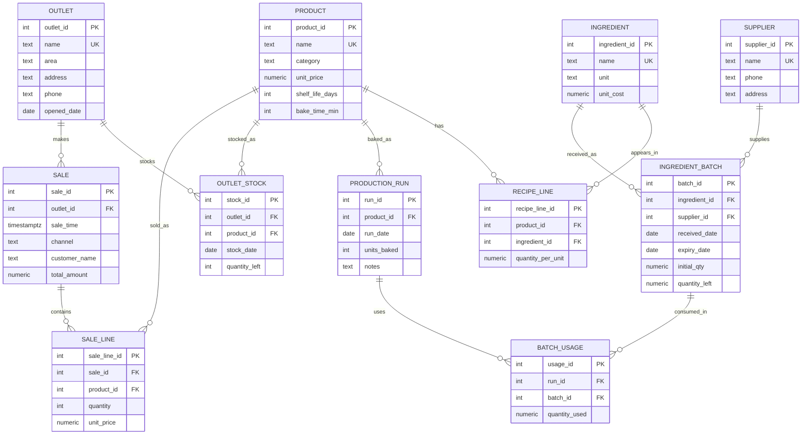

# Portfolio 1 — ER diagram for Crumble Studio

## Mermaid ER diagram (rendered automatically by GitHub)



## Relational schema (one line per table)

| # | Table | PK | Key FKs | Other constraints |
|---|-------|----|---------|-------------------|
| 1 | `outlet(outlet_id, name, area, address, phone, opened_date)` | outlet_id | — | name UNIQUE; opened_date ≤ today |
| 2 | `product(product_id, name, category, unit_price, shelf_life_days, bake_time_min)` | product_id | — | name UNIQUE; unit_price > 0; category IN (bread,pastry,pie,cookie) |
| 3 | `ingredient(ingredient_id, name, unit, unit_cost)` | ingredient_id | — | name UNIQUE; unit_cost > 0 |
| 4 | `supplier(supplier_id, name, phone, address)` | supplier_id | — | name UNIQUE |
| 5 | `recipe_line(recipe_line_id, product_id, ingredient_id, quantity_per_unit)` | recipe_line_id | product_id, ingredient_id | (product_id, ingredient_id) UNIQUE; quantity_per_unit > 0 |
| 6 | `ingredient_batch(batch_id, ingredient_id, supplier_id, received_date, expiry_date, initial_qty, quantity_left)` | batch_id | ingredient_id, supplier_id | quantity_left ≥ 0; quantity_left ≤ initial_qty; expiry_date > received_date |
| 7 | `production_run(run_id, product_id, run_date, units_baked, notes)` | run_id | product_id | units_baked > 0 |
| 8 | `batch_usage(usage_id, run_id, batch_id, quantity_used)` | usage_id | run_id, batch_id | quantity_used > 0; trigger forbids expired batch |
| 9 | `outlet_stock(stock_id, outlet_id, product_id, stock_date, quantity_left)` | stock_id | outlet_id, product_id | (outlet_id, product_id, stock_date) UNIQUE; quantity_left ≥ 0 |
| 10 | `sale(sale_id, outlet_id, sale_time, channel, customer_name, total_amount)` | sale_id | outlet_id | channel IN (counter,online); total_amount ≥ 0; online ⇒ name NOT NULL |
| 11 | `sale_line(sale_line_id, sale_id, product_id, quantity, unit_price)` | sale_line_id | sale_id, product_id | quantity > 0; unit_price > 0 |

(`supplier` is a small helper table; the 10 business tables required by the brief are
outlet, product, ingredient, recipe_line, ingredient_batch, production_run,
batch_usage, outlet_stock, sale, sale_line.)

## Normalisation (3NF) notes

All ten tables are in **3NF**:

* **1NF** — every column holds a single atomic value; no repeating groups. Sale lines
  are stored in their own `sale_line` table (not as an array inside `sale`), and recipe
  ingredients are stored in `recipe_line` (not as a comma-separated list).
* **2NF** — every non-key column depends on the *whole* primary key. The only composite
  candidate keys are `(product_id, ingredient_id)` in `recipe_line` (made unique) and
  `(outlet_id, product_id, stock_date)` in `outlet_stock` (made unique); in both, the
  non-key column (`quantity_per_unit`, `quantity_left`) depends on the whole triplet.
* **3NF** — no transitive dependency. `product.unit_price` lives on `product`, not on
  `sale_line`; we *do* copy `unit_price` into `sale_line` deliberately, because the
  price charged at the moment of sale is historical and must not change when the
  catalog price changes (a classic price-snapshot pattern, still 3NF because the
  snapshot column functionally depends on `sale_line_id`).

## Constraints summary

| Rule | Where enforced |
|------|----------------|
| Stock can never go below zero (ingredient_batch and outlet_stock) | `CHECK (quantity_left >= 0)` on both tables + defensive trigger `trg_outlet_stock_no_negative` |
| Expired ingredient batches cannot be used in a production run | trigger `trg_check_batch_not_expired` on `batch_usage` |
| A production run must consume exactly recipe × units, oldest unexpired batches first (FIFO) | `consume_batches_fifo(run_id)` called by trigger `trg_production_run_after_insert` |
| One stock row per outlet per product per day | `UNIQUE (outlet_id, product_id, stock_date)` on `outlet_stock` |
| Prices > 0 | `CHECK (unit_price > 0)` on `product` and `sale_line` |
| Online sale must have a customer name, counter sale must not | `CHECK` on `sale` |
| Expiry date must be after received date | `CHECK (expiry_date > received_date)` on `ingredient_batch` |

## How to view the ER diagram

GitHub renders the ```mermaid block above automatically when this file is opened in
the repo. Locally you can render it with:

```bash
# option 1: mermaid-cli
npx -y @mermaid-js/mermaid-cli -i portfolio-1-database-design/er_diagram.md -o er.png

# option 2: VS Code "Markdown Preview Mermaid Support" extension
```
